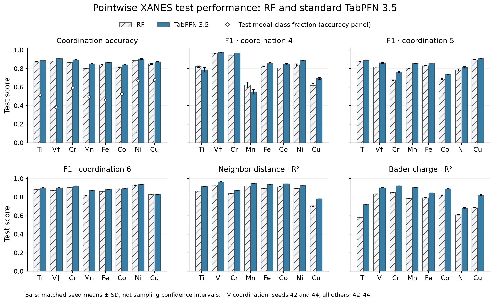
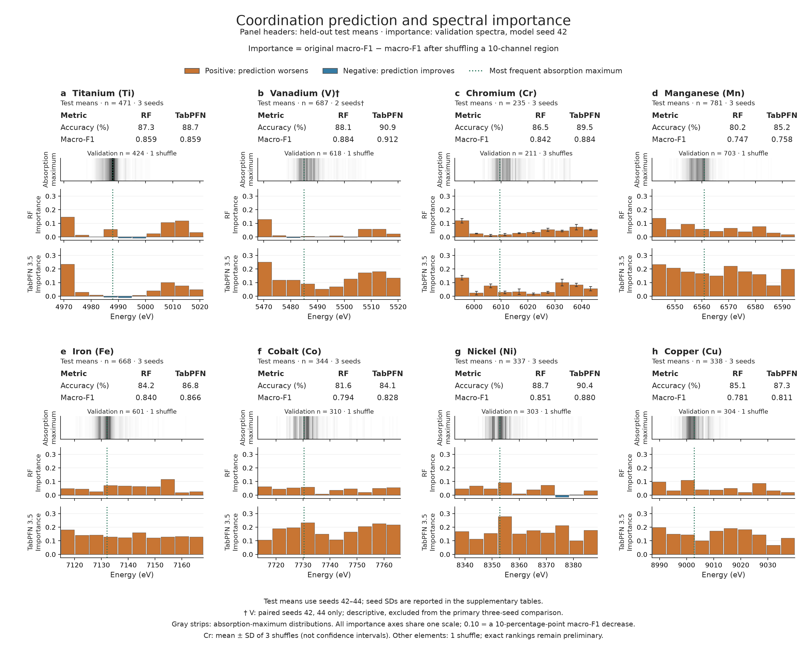

# Can a transformer beat random forests on X-ray data?

**Standard TabPFN 3.5 versus the published random-forest baseline on the TRIXS XANES benchmark.** Code, executed notebook, saved predictions and figures for an exploratory comparison across eight transition-metal elements.

[**Read the notebook**](notebooks/01_benchmark_results.ipynb) · [**Reproduce the results**](docs/REPRODUCIBILITY.md) · [**View the code**](xanes_benchmark/) · [**LinkedIn article**](https://www.linkedin.com/pulse/can-transformer-beat-random-forests-x-ray-data-feiyu-lu-xekec/)

## Quick start: reproduce the analysis

Recalculate the reported metrics and rebuild all four figures from the released predictions. This route needs **Python 3.11**, with no model weights or raw-data download.

```sh
git clone https://github.com/fredLuv/xanes-tabpfn-benchmark.git
cd xanes-tabpfn-benchmark
python3.11 -m venv .venv-report
.venv-report/bin/pip install -r environments/report.txt
.venv-report/bin/python -m xanes_benchmark verify
.venv-report/bin/python scripts/execute_notebook.py
```

Open the executed [results notebook](notebooks/01_benchmark_results.ipynb) to inspect the tables and regenerated charts.

## Run RF and TabPFN yourself

To regenerate predictions from the original training and held-out data, follow [data → RF → TabPFN → importance](docs/REPRODUCIBILITY.md#route-b--reproduce-model-predictions-from-the-authors-inputs). The runnable [full-suite script](scripts/reproduce.py) covers all eight elements. [Model and importance code](xanes_benchmark/inference.py) uses the exact archived splits and donor orders; [figure code](xanes_benchmark/figures.py) turns predictions into the four charts.

The guide covers the original archive, separate pinned environments, TabPFN checkpoint access, model fitting and inference, and regional permutation importance. Full model reruns require the data and weights; some recorded TabPFN cases require Apple MPS.

**Data to result:** original archive → verified arrays → RF fit / TabPFN training context → test predictions + validation permutations → metrics → figures → notebook.

## Findings

On the authors' archived test split, using matched model seeds:

| Target | TabPFN versus fixed RF |
|---|---|
| Average neighbor distance | MAE lower for all eight elements, by **31.6–47.1%** |
| Calculated partial charge (Bader charge) | MAE lower for all eight elements, by **13.1–37.8%** |
| Number of neighbors (coordination) | Macro-F1 higher in **six of seven** complete three-seed comparisons; Ti essentially unchanged |

Vanadium coordination has two matched seeds; the third TabPFN seed exceeded the memory limit. It is shown descriptively and excluded from the seven-case count. CN = 4 F1 decreased for Ti and Mn, despite higher overall accuracy. Improvements are relative to the published RF configuration on **one archived split**, not a claim of superiority over tuned tree models or on unseen materials.



## Which spectral regions matter?

We shuffle one contiguous energy region across validation spectra and measure the **decrease in macro-F1**, using the same permutations for RF and TabPFN. For Ti, V, Cr and Mn, both models' largest observed effects occur below the most common absorption-maximum energy. Useful predictive information extends beyond that maximum.



**Importance rankings are preliminary:** Cr uses three shuffles; the other seven elements use one matched shuffle. A 1,000-resample check of saved validation predictions shows some rankings are sensitive to which spectra are evaluated. It does not replace repeated donor shuffles. These are measures of model sensitivity, not transformer weights or causal physical explanations.

## Repository map

| Artifact | Contents |
|---|---|
| [Executed notebook](notebooks/01_benchmark_results.ipynb) | Performance, all eight importance maps, conditional stability and regression parity |
| [Methods and limitations](docs/METHODS.md) | Inputs, splits, model settings, interpretation and minimum follow-up |
| [Reproducibility](docs/REPRODUCIBILITY.md) | Copy-and-run instructions from the archive through inference, importance and figures |
| [Runnable model code](xanes_benchmark/inference.py) | RF/TabPFN construction and actual regional permutation inference |
| [Full-suite runner](scripts/reproduce.py) | Sequential test and importance reruns with recorded failures |
| [Figure builders](xanes_benchmark/figures.py) | Reconstruct all four charts from individual predictions |
| [Results](results/) | Individual predictions, run records, importance predictions and checksums |
| [Figures](figures/) | PNG and vector SVG versions of four figures |
| [Experiment configuration](configs/benchmark.json) | Input hashes, frozen settings and checkpoint revision |

The recorded experiments ran on an M4 Mac with 16 GB memory. Full inference requires the authors’ archive and separately obtained TabPFN weights; some recorded cases require Apple MPS. See [requirements and rerun commands](docs/REPRODUCIBILITY.md). Model reruns remain separate from the released evidence and include explicit agreement checks.

## Sources and attribution

- [Torrisi et al. (2020), original XANES study](https://www.nature.com/articles/s41524-020-00376-6)
- [Authors' dataset archive](https://data.matr.io/4/)
- [TRI-AMDD/TRIXS source code](https://github.com/TRI-AMDD/trixs)
- [TabPFN 3.5](https://priorlabs.ai/tabpfn-3-5) and [implementation](https://github.com/PriorLabs/TabPFN)
- [Permutation importance methodology](https://scikit-learn.org/stable/modules/permutation_importance.html)

Exploration and research direction by Feiyu Lu, prompted by a suggestion from Yang Ha. GPT-6 assisted with implementation, execution, analysis and artifact preparation under Feiyu's direction. This is a personal project, without institutional endorsement.

Code is licensed under [Apache 2.0](LICENSE); see [NOTICE](NOTICE) for attribution. Third-party datasets and pretrained weights retain their own terms and are not redistributed. This repository contains the public computational companion only.
